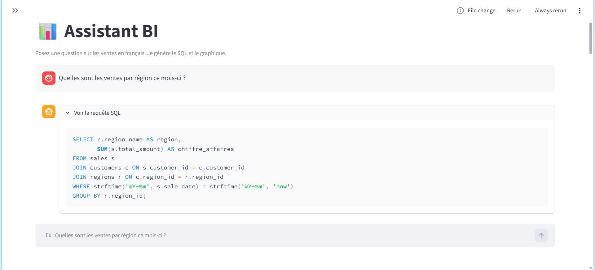

# 📊 Assistant BI : posez vos questions en français

Un assistant qui transforme une question en langage naturel
(*« Quelles sont les ventes par région ce mois-ci ? »*) en requête SQL,
l'exécute en lecture seule, puis affiche un graphique et un tableau.

## Fonctionnalités

- **Text-to-SQL** : génération de requêtes SQLite à partir du français (Groq, modèle `gpt-oss-120b`)
- **Sécurité** : seules les requêtes `SELECT` sont acceptées
  - validation par analyse syntaxique (AST) avec `sqlglot`
  - connexion SQLite en lecture seule
  - limite automatique à 1000 lignes
- **Auto-correction** : si le SQL échoue, l'erreur est renvoyée au LLM (2 essais maximum)
- **Graphiques automatiques** : courbe, barres ou camembert selon la forme des résultats
- **Interface Streamlit** : chat, historique, SQL visible, tableau et graphique
- **Cache** des réponses pour limiter les appels à l'API

## Comment ça marche

1. Le schéma de la base est lu automatiquement et inséré dans le prompt
2. Le LLM génère le SQL
3. Le SQL est validé (un seul `SELECT`, aucune opération dangereuse)
4. Il est exécuté en lecture seule
5. En cas d'erreur, le LLM reçoit le message d'erreur et corrige
6. Le résultat devient un graphique Plotly choisi par des règles simples
## Évaluation

La qualité est mesurée par l'**execution accuracy** : on compare les **résultats**
du SQL généré à ceux d'un SQL de référence écrit à la main, et non le texte du SQL
(plusieurs requêtes différentes peuvent donner le même résultat).

Jeu de test : 20 questions, du simple comptage aux jointures multiples avec `HAVING`.

| Version | Score | Changement |
|---|---|---|
| v1 | 70 % (14/20) | prompt de base |
| v2 | 80 % (16/20) | règles sur les valeurs de colonnes, la quantité et les dates |
| v3 | **90 % (18/20)** | pas d'identifiants dans le `SELECT`, règles « quel X » / « quels clients » |

**Analyse des erreurs.** Plusieurs échecs ne venaient pas d'un SQL faux :
le modèle renvoyait des colonnes en plus (par exemple `product_id`),
ce que la comparaison stricte refusait. Une question était aussi ambiguë
(« les 6 derniers mois » : mois calendaires ou 6 mois glissants ?).
Le prompt a été amélioré à partir de ces erreurs observées.

**Limites.** Seulement 20 questions et une seule base de démonstration.
Une partie des règles du prompt a été ajoutée après l'observation des échecs,
ce qui comporte un risque de sur-ajustement au jeu de test.

## Technologies

Python · Streamlit · SQLite · Plotly · pandas · sqlglot · Groq API

## Auteur

[kenza wahabi]